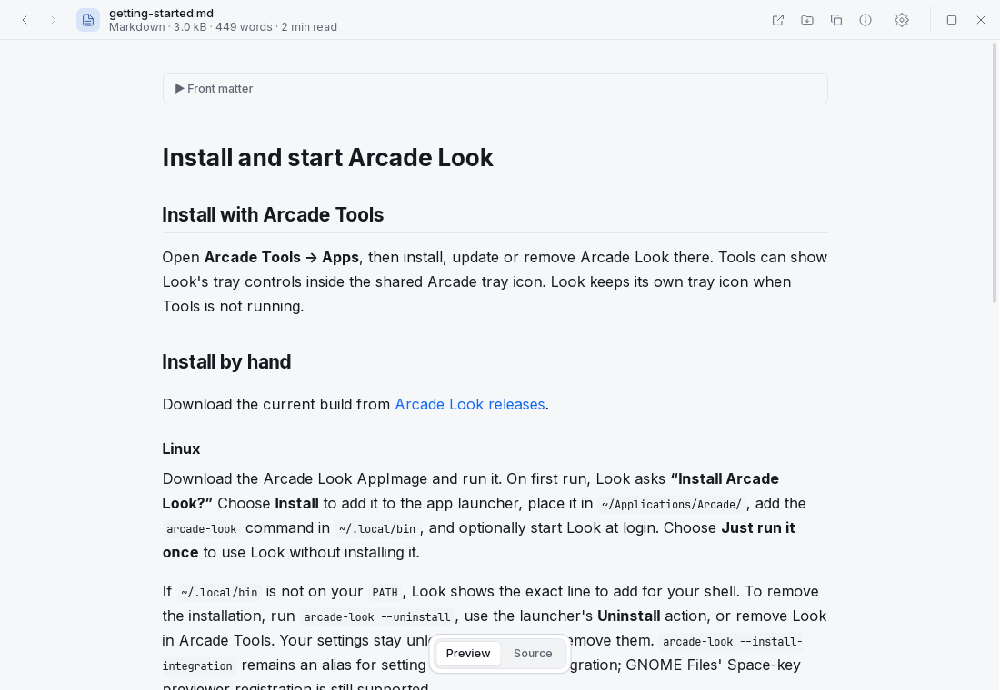

<p align="center">
  
</p>

<h1 align="center">Arcade Look</h1>

<p align="center">Press Space, see anything.</p>

<p align="center">
  <a href="https://github.com/qa-p1/Arcade-look/releases/latest"></a>
  <a href="https://github.com/qa-p1/Arcade-look/actions/workflows/ci.yml"></a>
</p>

---

Arcade Look is a quick file previewer. Preview images, media, documents, code, archives, fonts, 3D models and more without opening a full editor. It is for anyone who wants a macOS-style Quick Look from their file manager on every desktop.

It runs on **Linux** (x86_64; X11 and Wayland), **Windows** (x64) and **macOS** (universal: Apple Silicon and Intel). It is used daily on Hyprland; the Windows Explorer hook and macOS Finder integration are built and tested in CI but have not been run interactively.

<p align="center"></p>

## Download and install

Download the file for your system from [Releases](https://github.com/qa-p1/Arcade-look/releases). Or install it from **[Arcade Tools](https://github.com/qa-p1/Arcade-tools) → Apps**, which can also update and remove it.

| Platform | File | How to install |
|---|---|---|
| Linux x86_64 | `Arcade-Look_<version>_amd64.AppImage` | Run it. The first run asks **Install Arcade Look?** and installs to `~/Applications/Arcade/`, adds a menu entry, an `arcade-look` command in `~/.local/bin` and an optional start at login. **Just run it once** skips installing. GStreamer is bundled for video and audio. |
| Windows x64 | `Arcade-Look_<version>_x64-setup.exe` | Run Setup (NSIS, per-user, no admin). Adds a Start menu entry, an optional desktop shortcut and start at login, puts `arcade-look` on PATH and sets up the File Explorer integration. |
| macOS (universal) | `Arcade-Look_<version>_universal.dmg` | Open the dmg and drag Arcade Look to Applications. Run from the dmg or Downloads, it offers to move itself to Applications. |

- Scripted install: `arcade-look --install --silent` (add `--no-launch`, or `--channel C`). `--repair` repairs the integration recorded in the install receipt; `--integration-status` prints it as JSON. A silent install removes the AppImage it was started from only when that file is in your Downloads folder; add `--keep-download` to keep it there too. Files elsewhere are never removed.
- If `~/.local/bin` is not on your PATH, Look shows the exact line to add for your shell.
- Builds are unsigned. On Windows, SmartScreen may warn: choose **More info → Run anyway**. On macOS the app is not notarized: Control-click or right-click it and choose **Open** the first time.
- If FUSE is missing on Linux, run the AppImage with `--appimage-extract-and-run`.

See [Install and start Arcade Look](docs/user/getting-started.md).

## Features

- **Many formats:** images and camera RAW, video and audio, PDF, DOCX/ODT/RTF/EPUB, CSV and Excel/OpenDocument spreadsheets, PPTX/ODP, Markdown, source code, JSON, JSON Lines, GeoJSON, Jupyter notebooks, fonts, 3D models, HTML, folders, and ZIP/TAR-family archives (preview entries in place).
- **Images:** zoom toward the pointer, pan, rotate, fit, actual size, transparency checkerboard, dimensions, EXIF and GPS details.
- **Documents and data:** selectable PDF text with page navigation, formatted documents with tables and images, a virtualized spreadsheet grid with sheet tabs, slides with speaker notes.
- **Code:** line numbers, wrapping, adjustable text size, encoding detection; Markdown renders GitHub-flavored content; JSON as a collapsible tree; HTML rendered in a sandbox without scripts.
- **Media, fonts, models:** playback controls, cover art, tags and waveform; editable font samples with variable-axis sliders and a glyph grid; 3D orbit, wireframe, PBR lighting and animations.
- **Browse folders:** a folder opens as a grid; Back/Forward history and Left/Right to move between files.
- **Fallback:** if a format has no viewer or its decoder fails, Look shows a file information card and a hex view.
- **Plugins:** command plugins turn a CLI into a previewer; script plugins are ES modules that render into the preview pane. Examples in [examples/plugins](examples/plugins) (LibreOffice, Pandoc, ffmpeg transcoding fallback, SQLite schema, color palettes); reference in [docs/PLUGINS.md](docs/PLUGINS.md).
- **Fast:** after you close a preview the window stays warm so the next one is instant; after 30 seconds hidden, the web view is released.

More in [Preview, browse and extend files](docs/user/features.md).

## Works with other Arcade apps

Look works on its own. It connects to other installed Arcade apps automatically over Arcade Link, **without needing Arcade Tools**. Manage connections in **Settings → Connected apps**; actions appear only when the peer supports the current content and is enabled. Press **A** or open the Actions button to use them.

| App | What Look does with it |
|---|---|
| Arcade Box | Send a compatible file to a Box tool, preset or saved pipeline. Returned files open in Look. |
| Arcade Clipboard | Send a supported file or image to your devices. |
| Arcade Lens | Send a supported image, or the current PDF page, for analysis. |
| Arcade Wheel | **Add to Wheel** saves a compatible preview action in a Wheel slot. Wheel can use Look's file-selection resolver where Look exposes it (not on Linux Wayland). |
| Arcade Shelf | **Add to Shelf** keeps a file reference in a Shelf collection. |
| Arcade Find | Shown in Connected apps for connection status; no action in Look's Actions menu yet. Find uses Look for Quick Look. |
| Arcade Tools | Install, update or remove Look from its **Apps** tab. |

Previews never execute content, whoever asked.

When Arcade Tools is running, its tray icon hosts Look's menu. When Tools quits, crashes or turns hosting off, Look's own icon returns at once. With "Connect with other Arcade apps" off, Look always shows its own icon.

See [Use Arcade Look with other apps](docs/user/with-other-apps.md) and the [Arcade Link reference](docs/arcade-link.md).

## Usage

The preview trigger depends on your platform:

- **GNOME Files on Linux:** select a file and press **Space**. Look registers as a GNOME Files previewer.
- **Other Linux file managers:** use **Open With → Arcade Look**, or configure the file manager to run `arcade-look` with the selected path.
- **Windows:** **Space** in File Explorer when the Explorer integration is enabled, or **Ctrl+Alt+Shift+Space** to preview the current selection.
- **macOS:** select a file in Finder and press **Control+Option+Space**. Finder's own Space preview remains available.

You can also run `arcade-look path/to/file` or drop a file or folder on the window.

| Key | Action |
|---|---|
| Space / Esc | Close (Esc exits fullscreen first) |
| ← / → | Previous / next file in the folder |
| Backspace, Alt+← / Alt+→ | Back / forward in navigation history |
| Enter or Ctrl+O | Open with the default app |
| Ctrl+R | Reveal in folder |
| Ctrl+C | Copy the file path when no text is selected |
| I | File information |
| F | Fullscreen |
| + / - / 0 | Zoom |
| A | Connected actions |
| ? | All shortcuts for the current viewer |
| Ctrl+Q | Quit |

On macOS, Cmd replaces Ctrl. See the [shortcut reference](docs/user/shortcuts.md).

### Command line

```
arcade-look [OPTIONS] [PATH]

ARGS:
    PATH                     File or folder to preview (a file:// URI works too)

OPTIONS:
    --service                Start in the background without a window
    --settings               Open the settings
    --restart                Restart the running instance
    --install [--silent] [--no-launch] [--keep-download] [--channel C]
                             Install this AppImage or move this macOS app bundle
    --install-integration    Alias for --install
    --uninstall [--silent] [--remove-data]
                             Remove this installation using its receipt
    --uninstall-integration  Alias for --uninstall
    --repair                 Repair integration recorded in the install receipt
    --integration-status     Print receipt and integration status as JSON
    --quit                   Quit the running instance
    --arcade-manifest        Print the Arcade Link manifest (no side effects)
    --arcade-invoke          Run one Arcade Link request from stdin, without any UI
    -h, --help               Show this help
    -V, --version            Show the version
```

## Settings and data

Settings live in `config.json` in your config folder: `~/.config/arcade-look/` on Linux, `~/Library/Application Support/arcade-look/` on macOS, and `%APPDATA%\arcade-look\` on Windows. The welcome screen links to it.

Log messages go to `logs/arcade-look.log` in the same folder.

```jsonc
{
  "theme": "system",            // "system" | "light" | "dark"
  "idleMinutes": 10,            // exit after this many idle minutes if no background services need Look (0 = never)
  "globalShortcut": "Ctrl+Alt+Shift+Space", // Windows default; macOS Ctrl+Alt+Space; Linux ""
  "explorerSpace": true,        // Windows: Space in File Explorer
  "nautilusPreviewer": true,    // Linux: Space in GNOME Files
  "textLimitMb": 4,             // text previews read at most this much
  "highlightLimitKb": 512,      // no syntax colors above this size
  "autoplay": true,             // start video/audio automatically
  "plugins": true,
  "showHidden": false           // include dotfiles when pressing ←/→
}
```

Once hidden for 30 seconds, the web view is released, even when `idleMinutes` is 0. The Rust process keeps serving Link without a webview. Start-at-login, the tray, the Windows Explorer hook and global shortcuts keep it running; if none of them is needed, it exits after `idleMinutes` (0 disables automatic exit), and other Arcade apps start it again when they need it. The final ecosystem benchmark measured about 74.5 MiB for Look at its three-second idle sample; it did not measure the post-timeout state separately.

Arcade Tools can export and import Look's settings: theme, idle minutes, global shortcut, text and highlight limits, autoplay and show hidden files. Imports are validated, the current settings are backed up, and they apply live. Nothing outside that list is exported. Look does not keep a clipboard history.

## Uninstall

- **Linux:** run `arcade-look --uninstall`, use the launcher's **Uninstall** action, or remove Look in Arcade Tools.
- **Windows:** **Settings → Apps** (Apps & features), or Arcade Tools.
- **macOS:** `arcade-look --uninstall` removes the installation recorded in its receipt, or remove Look in Arcade Tools.

Your settings stay unless you choose to remove them (`--remove-data`, or *Remove settings and data* in Arcade Tools). That also removes the preview's web storage and caches: `~/.local/share/app.arcadelook` and `~/.cache/app.arcadelook` on Linux, `%LOCALAPPDATA%\app.arcadelook` on Windows, and `~/Library/WebKit/app.arcadelook` and `~/Library/Caches/app.arcadelook` on macOS.

## Platform notes

- Video and audio codecs are whatever the OS web engine supports: WebView2 on Windows, AVFoundation on macOS, GStreamer on Linux (install `gstreamer1.0-libav` for H.264/AAC). Unsupported media falls back to the info card; the ffmpeg example plugin can transcode it.
- Legacy binary `.doc`/`.ppt` need a plugin, such as the optional LibreOffice example; Look does not require or install LibreOffice. (`.xls` works natively.)
- Wayland does not allow global shortcuts or reading another app's selection, so on Linux Space works through GNOME Files' previewer protocol, and other file managers use **Open With** or custom actions.
- The Windows Explorer hook and macOS Finder integration are built, linted and unit-tested in CI on their platforms but have not been run interactively. The Linux path is exercised end to end, including Arcade Link's isolated cross-app runner. See [docs/STATUS.md](docs/STATUS.md).

## Build from source

Requirements: [Rust](https://rustup.rs) (stable, 1.88+), Node.js 20+, and on Linux the [Tauri system dependencies](https://tauri.app/start/prerequisites/) (`libwebkit2gtk-4.1-dev`, `libgtk-3-dev`, `librsvg2-dev`, …).

```sh
npm install
npm run tauri dev            # run with hot reload
npm run tauri build          # installers in src-tauri/target/release/bundle/
```

Checks:

```sh
python3 scripts/verify-link.py
```

Checks use `src-tauri/target/link-tests` and an empty temporary `ARCADE_HOME`. Use `python3 scripts/verify-link.py --build-e2e` to also build the native test driver there. Keep the normal debug binary ready to run with its embedded frontend: `npx tauri build --debug --no-bundle`.

`npm run fixtures` writes a sample of every supported format to `fixtures/` for manual testing. Set `ALOOK_DEBUG=1` to print lifecycle, protocol and UI diagnostics to stderr.

### Architecture

```
file manager ──Space──▶ OS integration ──▶ Rust core ──IPC / alook://──▶ web UI (lazy viewers)
                         Linux: D-Bus     detect · parse · stream          registry → fallback chain
                         Windows: hook    (Range-aware protocol)           image · pdf · code · …
                         macOS: shortcut
```

- **Rust core** (`src-tauri/src`): magic-byte and extension detection, parsers (Office XML, archives, fonts, tags, EXIF, PSD, RAW previews), a streaming `alook://` protocol with HTTP Range, plugins, and window lifecycle.
- **Web UI** (`src/`): vanilla TypeScript with no framework runtime. Each viewer is its own lazily loaded chunk with `mount()`/`dispose()`. A viewer that throws falls through to the next one.
- On Linux, `<video>`/`<audio>` stream from a token-protected loopback HTTP server, because WebKitGTK's media stack cannot stream from custom URL schemes.

The full design rationale is in [docs/PLAN.md](docs/PLAN.md).

### Releases

CI (`.github/workflows`) checks every pull request, and packages every push to `main` (`build.yml`: NSIS setup `.exe`, AppImage, universal `.dmg`). When that succeeds, `release.yml` publishes the installers: as release `v<version>` if `version` in `src-tauri/tauri.conf.json` hasn't been released yet, otherwise as the rolling `nightly` pre-release. To ship a new version, bump `version` (also in `src-tauri/Cargo.toml` and `package.json`) and push. A draft release for that version is filled in and published rather than skipped. No secrets are required; if the built-in token can't create a tag (it can't tag an older commit whose workflow files differ from `main`'s), add a `RELEASE_TOKEN` secret with the `workflow` scope and `release.yml` uses it instead.

## Documentation

- [User guide](docs/user/): [getting started](docs/user/getting-started.md), [features](docs/user/features.md), [shortcuts](docs/user/shortcuts.md), [FAQ](docs/user/faq.md), [troubleshooting](docs/user/troubleshooting.md)
- [Arcade Link](docs/arcade-link.md): actions Look exposes and uses
- [Plugins](docs/PLUGINS.md)
- [Design plan](docs/PLAN.md)
- [Status](docs/STATUS.md)
- [Changelog](CHANGELOG.md)

## License

[MIT](LICENSE)

---

<p align="center">
  Part of the <b>Arcade</b> suite:
  <a href="https://github.com/qa-p1/Arcade-Find">Find</a> ·
  <a href="https://github.com/qa-p1/Arcade-lens">Lens</a> ·
  <a href="https://github.com/qa-p1/Arcade-look">Look</a> ·
  <a href="https://github.com/qa-p1/Arcade-box">Box</a> ·
  <a href="https://github.com/qa-p1/Arcade-clipboard">Clipboard</a> ·
  <a href="https://github.com/qa-p1/Arcade-Shelf">Shelf</a> ·
  <a href="https://github.com/qa-p1/Arcade-wheel">Wheel</a> ·
  <a href="https://github.com/qa-p1/Arcade-tools">Tools</a> ·
  <a href="https://github.com/qa-p1/Arcade-catalog">Docs</a>
</p>
